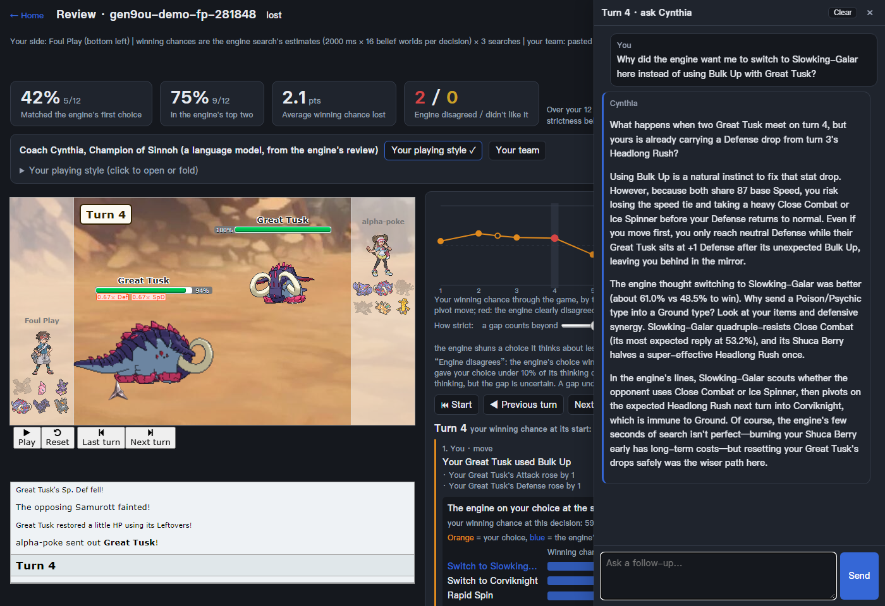

# alpha-poke

[](https://github.com/freiz/alpha-poke/actions/workflows/ci.yml)
[](LICENSE)

An AI for Pokémon Showdown's Gen 9 OU singles: tree search over the opponent's possible hidden
sets, guided by a small neural network trained on human games. A research project on one
desktop (20 CPU threads, an RTX 4070 Ti), so experiments are slow.

## The problem

Gen 9 OU is a two-player game with **simultaneous moves** (both players choose before either
acts), **hidden information** (at team preview each side sees only the opponent's six species;
moves, items, abilities and tera types come out during the game, EVs and natures never do) and
**a lot of chance** (damage rolls, accuracy, secondary effects, critical hits). A good move
depends on what the opponent probably has and probably does, not on a single known position.

## Our approach

```
Showdown battle (poke-env: protocol, battle tracking)
  │
  ├─ belief: 32 "worlds", each a guess of the opponent's full sets, sampled from priors
  │          conditioned on their team and updated by everything seen so far
  ├─ state construction: each world as an exact simulator state (timers, PP, volatiles, ...)
  ▼
search (Rust): ISMCTS -- one search tree shared by all worlds; each iteration plays one world;
  both sides choose by PUCT, guided by the network's move priors and position values
  ▼
the most visited action
```

- **Belief**: priors over the opponent's sets conditioned on the whole team (from a recognized
  team down to species usage), updated in battle by revealed moves and items, how likely a move
  would have shown by now, the move order (speed) and damage rolls.
- **Search**: information-set Monte Carlo tree search (ISMCTS). Because every world adds its
  results to the same nodes, a choice anywhere in the tree has to be good across all the
  opponent sets that fit what we know, rather than "cheating" by assuming one of them. It runs
  on a patched [poke-engine](https://github.com/pmariglia/poke-engine); Showdown's own simulator
  is the reference for every rule.
- **Network**: a small transformer (about 742k parameters) over the 12 Pokémon, the field and
  the recent turns, with damage and speed calculations from the simulator as inputs. It outputs
  a move distribution (the search's priors) and a win probability (the search's leaf values).
- **Training**: supervised on about 2.3M human games (imitating the players' choices and
  predicting the winner). We are also trying self-play (the search's choices and the game
  results as targets), so far without a clear gain (below).

More: [doc/design.md](doc/design.md) (decisions and their evidence),
[doc/model_card.md](doc/model_card.md) (the released network).

## Results

Paired evaluation: each pair of teams (taken from real games) is played twice, the teams
exchanged; ± 95% confidence intervals.

| | result |
|---|---|
| vs [Foul Play](https://github.com/pmariglia/foul-play), 200 ms × 1 thread per move each | 65.0% ± 4.1% (199 pairs); 67.7% ± 3.5% (300 pairs) |
| vs Foul Play, 5 s × 2 threads per move each | 67.1% ± 6.3% (108 pairs) |
| the network vs the simulator's handcrafted evaluation, inside the search | 66.3% ± 5.2% |
| the network on held-out human positions | predicts the player's move 55.9%, the winner 71.7% |

Foul Play is the strongest open-source Showdown bot we know of. These numbers compare two bots
on our machine; they say little about play against people. Every number and how it was
measured: [doc/results.md](doc/results.md).

## Limitations and what's next

- **No results against strong players.** The bot has played a handful of friendly games; ladder
  games wait on the bot account's registration ([#20](https://github.com/freiz/alpha-poke/issues/20)).
- **Self-play has not worked well yet.** Its networks gain a little, and how much depends on how
  we measure: with deeper searches the gain seems to shrink
  ([#26](https://github.com/freiz/alpha-poke/issues/26)), and the self-play games themselves are
  noisy in ways that may hurt the value targets ([#27](https://github.com/freiz/alpha-poke/issues/27)).
  We are investigating; no self-play network is released.
- **The opponent model is coarse.** The search treats the opponent as if it, too, did not know
  its own sets ([#10](https://github.com/freiz/alpha-poke/issues/10)), and the bot always plays
  its most visited move, which an adaptive opponent can exploit
  ([#7](https://github.com/freiz/alpha-poke/issues/7)).
- **The simulator is an approximation** of Showdown's; known differences are tracked
  ([#2](https://github.com/freiz/alpha-poke/issues/2), [#5](https://github.com/freiz/alpha-poke/issues/5)).

All open problems: [GitHub issues](https://github.com/freiz/alpha-poke/issues). Questions and
suggestions are welcome there.

## Try it

Linux or WSL2, [uv](https://docs.astral.sh/uv/), Node.js ≥ 22.18, a Rust toolchain, git. A CUDA
GPU is optional.

```bash
git clone https://github.com/freiz/alpha-poke && cd alpha-poke
uv sync --all-groups                 # all groups: a plain `uv sync` removes torch
uv run python scripts/fetch_model.py # the released network + belief models (SHA-256 checked)
./scripts/start_showdown.sh 8000     # a local Showdown server (leave it running)

# watch it play poke-env's heuristic bot (200 ms per move)
uv run python scripts/eval_pairs.py s_ismcts_ma heuristic --pairs 5 --procs 1 --lanes 2 --ports 8000
# play against it: open http://localhost:8000 as "me", then challenge it to Gen 9 OU
uv run python scripts/play_public.py --opponent me --n 3 --difficulty hard
```

Against Foul Play, the bots and their settings: [doc/evaluation.md](doc/evaluation.md).

### Game reviews



*A game between our bot and Foul Play, reviewed from Foul Play's side with its team pasted. On
turn 4 its Great Tusk, down a Defense stage from Headlong Rush, used Bulk Up in the mirror; the
engine preferred switching to Slowking-Galar (61% against 48.5%), which resists the Close Combat
it expected four times over. On the right, the coach (Cynthia, played by a language model)
answers the player's question about it.*

The same search, as a review **engine**, gives a second opinion on a Gen 9 OU singles game,
decision by decision: each option's estimated winning chance, the player's choice and the
engine's. An optional **coach** -- a language model you set up (a cloud model, or a local one
with Ollama) -- reads that analysis and writes about your style and your team, and answers your
questions on any decision, in a character's voice. It may help newer players spot clear slips.
It is not a verdict on strong players: we have no evidence the engine's choices are better than
theirs, and its numbers are estimates with blind spots of their own (for example, plans that
pay off many turns later).

```bash
uv run python scripts/review_server.py      # the review app: http://127.0.0.1:8090
```

Paste a replay link (optionally your team or its PokéPaste link); the review appears next to
Showdown's own replay player, and past reviews stay in a searchable list. Windows / macOS
builds need nothing installed; the coach needs only a model's address (and key) on the home
page. The builds are not signed, so the first start shows a system warning; the `README.txt` in
each zip gives the steps. More: [doc/reviews.md](doc/reviews.md).

## For developers

- **Training from scratch**: about 100 GB of disk and 30+ GB of RAM; the steps and the released
  recipe are in [doc/model_card.md](doc/model_card.md). Compare networks by playing them, not by
  offline metrics alone: the two have disagreed before.
- **Self-play**: `scripts/selfplay.py iterate --gen 0 --once` (GPU): games of the current
  network against itself, fine-tuning on them mixed with human data, then a sequential test on
  team pairs drawn from a held-out bank of real ladder teams. Design:
  [doc/design.md](doc/design.md) D15–D16.
- **Team design** for games against people: [doc/team_design.md](doc/team_design.md).
- **Engine correctness**: every rule difference from Showdown is confirmed by a Showdown test
  and a simulator test that agree, then fixed; recorded battles are replayed turn by turn
  against Showdown. Logs: [doc/difftest.md](doc/difftest.md),
  [doc/engine-diff.md](doc/engine-diff.md), [doc/state-diff.md](doc/state-diff.md).
- **Layout**: `src/alpha_poke/` (agents, belief, replay, train, selfplay, eval, coach, ...),
  `rust/` (the search and the patched simulator), `scripts/` (entry points, usage in each
  docstring), `tests/`, `doc/`. `data/` is git-ignored; its layout is in
  `src/alpha_poke/paths.py`.
- **Tests**: `scripts/start_showdown.sh --setup` once, then `uv run pytest -n 8` (about 1,500
  tests, on the repository's fixtures only) and `scripts/lint.sh`. CI runs both on every push.

## Data, licenses and the official server

- Replays: [Metamon](https://huggingface.co/datasets/jakegrigsby/metamon-raw-replays)'s Gen 9 OU
  dataset, the [HolidayOugi](https://huggingface.co/datasets/HolidayOugi/pokemon-showdown-replays)
  dump and public replays of the official server (a polite crawler, about one request per 2 s).
  Neither dataset states a license; they are used locally and not redistributed. The only game
  logs in this repository are 200 scrubbed ones in the tests' fixtures: no nicknames, timestamps
  or real game ids (`tests/make_fixture_data.py`).
- [Smogon usage statistics](https://www.smogon.com/stats/) and forum teams (sets only).
- Evaluation and self-play run on local servers only. `play_public.py` and `ladder.py` connect
  to the official server only with `--public` and a registered bot account (Showdown's bot
  policy); they never join rooms, chat or challenge anyone.
- The code is MIT ([LICENSE](LICENSE)). That covers our code, not the third-party data kept here
  for tests and evaluation: `teams/` (sets from Smogon forum posts and from ladder games) and
  `tests/fixtures/` (Smogon's statistics, scrubbed game logs) stay under their sources' terms.
- The released model files are for non-commercial research use: the replays they were trained on
  are public games, but neither dataset states a license, so we cannot offer more than that. If
  you hold rights in any of this data and object, please open an issue and we will remove it.
- Foul Play (GPL-3.0) runs as a separate process, Showdown's client (AGPL-3.0) is fetched and
  served unmodified for local viewing, poke-engine is MIT. The desktop builds carry their
  third-party licenses (`THIRD_PARTY_LICENSES.txt`).

## References

**Software we build on or compare with**

- [Pokémon Showdown](https://github.com/smogon/pokemon-showdown): the battle simulator and
  client; the reference for every rule.
- [poke-env](https://github.com/hsahovic/poke-env): the Python interface to Showdown battles.
- [poke-engine](https://github.com/pmariglia/poke-engine): the fast simulator our search runs
  on (patched).
- [Foul Play](https://github.com/pmariglia/foul-play): the open-source Showdown bot we evaluate
  against.
- [Metamon](https://github.com/UT-Austin-RPL/metamon): offline RL agents for earlier
  generations, and the replay dataset we train on.

**Data**

- [Metamon raw replays](https://huggingface.co/datasets/jakegrigsby/metamon-raw-replays),
  [HolidayOugi's Showdown replays](https://huggingface.co/datasets/HolidayOugi/pokemon-showdown-replays),
  [Smogon usage statistics](https://www.smogon.com/stats/), [PokéPaste](https://pokepast.es/).

**Papers**

- P. I. Cowling, E. J. Powley, D. Whitehouse. [Information Set Monte Carlo Tree
  Search](https://doi.org/10.1109/TCIAIG.2012.2200894). IEEE TCIAIG, 2012.
- D. Silver et al. [Mastering Chess and Shogi by Self-Play with a General Reinforcement
  Learning Algorithm](https://arxiv.org/abs/1712.01815) (AlphaZero), 2017.
- D. J. Wu. [Accelerating Self-Play Learning in Go](https://arxiv.org/abs/1902.10565)
  (KataGo), 2019.
- J. Grigsby, Y. Xie, J. Sasek, S. Zheng, Y. Zhu. [Human-Level Competitive Pokémon via
  Scalable Offline Reinforcement Learning with Transformers](https://arxiv.org/abs/2504.04395)
  (Metamon), RLC 2025.
